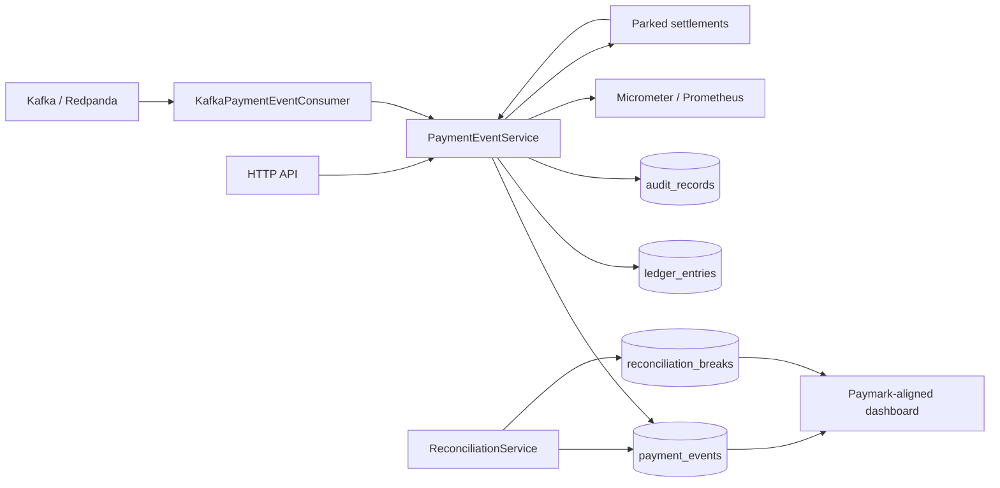
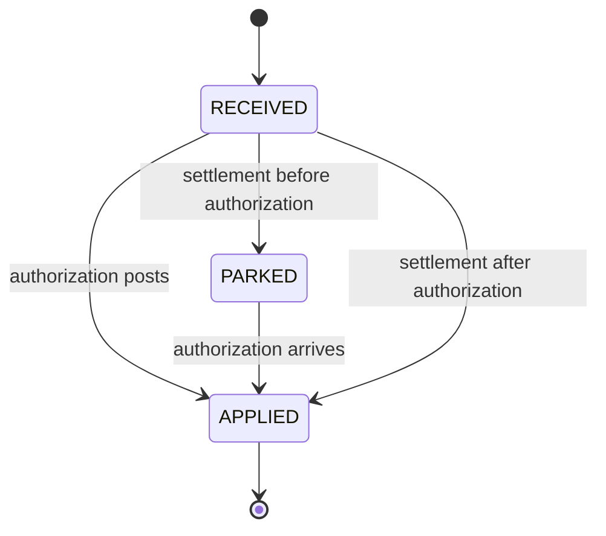

# Settlement Guard

**An out-of-order-tolerant settlement and reconciliation engine for payment switches — Java 17 / Spring Boot, Kafka-ready, MySQL, Python and a Paymark-aligned operations UI.**

[](https://github.com/itsoumya-d/settlement-guard/actions/workflows/ci.yml)
[](https://adoptium.net/)
[](https://spring.io/projects/spring-boot)
[](LICENSE)

> Clean-room reference implementation. Not affiliated with, endorsed by, or copied from Paymark, Worldline or Cuscal. No proprietary code, customer data, credentials or internal systems were used. The starting point was public job descriptions, the public developer portal, the public status page and public incident reporting.

---

## The problem

Paymark/Worldline NZ processes billions of EFTPOS and online payment transactions. Public status data shows the operational reality behind that scale:

- **23 incidents in the last 90 days** and **98.26% uptime** across tracked services (`pingoru.io/providers/paymark/outage-history`).
- On **1 November 2026**, a settlement delay affected MPGS ecommerce transactions: *"some merchants may not have received their settlement overnight for this date as expected."*
- On **27 October 2026**, the Insights data feed was incomplete: *"Transaction reporting data for 27/10/2026 may be incomplete due to this issue."*
- On **1 November 2026**, a Spark connectivity outage ran for **10 hours 21 minutes**, affecting terminal connectivity to the Paymark network.

The common engineering failure mode is not the network outage itself. It is what happens afterwards: settlement files arrive late or out of order, duplicate events appear, authorizations are missing, and reconciliation becomes a manual queue. Merchants lose confidence because nobody can say which transactions are safe, parked, duplicated or still missing.

**Settlement Guard** is a clean-room fix for that failure mode.

## What it does

1. **Idempotent ingestion** — the same terminal/STAN/RRN/event type cannot post twice. A replay returns `DUPLICATE`; a different payload returns `409`.
2. **Out-of-order parking** — a settlement that arrives before its authorization is parked, not dropped. When the authorization arrives, the parked settlement is applied automatically.
3. **Double-entry ledger** — every authorization, settlement, reversal and refund posts balanced debits and credits.
4. **Explicit reconciliation** — a settlement row is classified as `MATCHED`, `MISSING_AUTHORIZATION`, `DUPLICATE_SETTLEMENT`, `AMOUNT_MISMATCH` or `DELAYED_SETTLEMENT`.
5. **Operations visibility** — a Paymark-aligned dashboard shows events, parked settlements, reconciliation breaks and ledger balance.
6. **Alerting hooks** — Micrometer/Prometheus metrics and Terraform alarms for parked settlements and reconciliation breaks.
7. **Kafka-ready** — the same ingestion path is available through a Kafka listener; the HTTP API is the synchronous control plane.

## Stack

| Layer | Technology |
| --- | --- |
| API | Java 17, Spring Boot 3.3, Spring Web, Validation, Actuator |
| Persistence | MySQL 8, JPA/Hibernate, Flyway |
| Events | Kafka / Redpanda-ready consumer, transactional outbox pattern |
| Reconciliation | Java service + independent Python CLI (`tools/reconcile.py`) |
| UI | Static HTML/CSS/JavaScript with Paymark design tokens |
| Infrastructure | Docker, Docker Compose, Kubernetes manifests, Terraform (SQS/SNS/CloudWatch) |
| Quality | JUnit 5, MockMvc, Testcontainers MySQL, pytest, GitHub Actions |

## Paymark design tokens

Extracted from the live Paymark site and its CSS:

| Token | Value |
| --- | --- |
| Body font | `Roboto`, sans-serif |
| Body size / line height | `18px / 27px` |
| H1 | `60px / 64.8px`, weight `600`, tracking `normal` |
| H2 | `44px / 49.28px`, weight `600`, tracking `normal` |
| Eyebrow | `14px / 19.6px`, weight `600`, tracking `1.68px`, `#e6746b` |
| Primary red | `#d9291c` |
| Ink | `#1e1e1e` / `#000000` |
| Surface | `#f9f9f9` |
| Line | `#e9e9e9` |
| Focus blue | `#36c6f9` |
| Radius | `5px` |
| Button | red background, white text, `16px/600`, tracking `0.5px`, padding `11px 24px` |

The dashboard uses these tokens in `src/main/resources/static/styles.css`. The CV uses the same family, weights, accent and radius values. See `docs/design-tokens.md`.

## Architecture



### State machine



### Ledger accounts

| Event | Debit | Credit |
| --- | --- | --- |
| Authorization | `MERCHANT_RECEIVABLE` | `AUTHORIZATION_HOLD` |
| Settlement / clearing | `SETTLEMENT_CLEARING` | `MERCHANT_RECEIVABLE` |
| Reversal | `AUTHORIZATION_HOLD` | `MERCHANT_RECEIVABLE` |
| Refund | `MERCHANT_RECEIVABLE` | `SETTLEMENT_CLEARING` |

Every event posts two entries. The dashboard exposes total debits and credits and flags an imbalance.

## Quickstart

### Local demo (H2, no Docker)

```bash
./gradlew bootRun --args='--spring.profiles.active=local'
open http://localhost:8080
```

The `local` profile seeds matched, delayed, parked and duplicate settlement examples, then runs a reconciliation.

### MySQL + Kafka (Docker Compose)

```bash
docker compose up --build
open http://localhost:8080
```

### Manual API

```bash
curl -X POST http://localhost:8080/api/v1/payments/events \
  -H 'Content-Type: application/json' \
  -d '{
    "terminalId": "TERM-001",
    "stan": "123456",
    "rrn": "RRN-9001",
    "eventType": "AUTHORIZATION",
    "amountCents": 12500,
    "currency": "NZD",
    "eventTime": "2026-11-04T00:00:00Z",
    "sequence": 1,
    "payloadHash": "auth-RRN-9001"
  }'
```

Submit a settlement before its authorization and you will see:

```json
{
  "rrn": "RRN-9001",
  "status": "PARKED",
  "parkedReason": "AUTHORIZATION_NOT_SEEN"
}
```

Once the authorization arrives, the parked settlement is applied and the ledger balances.

### Reconciliation

```bash
curl -X POST http://localhost:8080/api/v1/reconciliation/runs \
  -H 'Content-Type: application/json' \
  -d '{
    "filename": "settlement-2026-11-04.csv",
    "rows": [
      {"rrn": "RRN-9001", "amountCents": 12500, "currency": "NZD", "settledAt": "2026-11-04T02:00:00Z", "terminalId": "TERM-001", "stan": "123456"}
    ]
  }'
```

### Independent Python control

```bash
python tools/reconcile.py \
  --settlements tools/fixtures/settlements.csv \
  --ledger tools/fixtures/ledger.csv
```

This is deliberately a second implementation, the way a payments team keeps an independent reconciliation control beside the service.

## Tests

```bash
./gradlew test          # 17 Java tests; MySQL Testcontainers test runs when Docker is available
python -m pytest tools -q  # 6 Python tests
```

Coverage includes idempotent replay, payload conflicts, settlement-before-authorization parking, double-entry balance, reconciliation classifications, audit-chain tamper detection, HTTP validation and MySQL 8 Flyway validation.

## Evidence and research

- `docs/pain-point.md` — public Paymark incidents and the fix.
- `docs/architecture.md` — state machine, ledger, Kafka and reconciliation.
- `docs/design-tokens.md` — exact Paymark typography and colour extraction.
- `docs/evidence-matrix.md` — role requirement → implementation → test.
- `infra/terraform/` — SQS/DLQ/SNS/CloudWatch alarms.
- `k8s/` — deployment, service, HPA and secret example.

## Paymark role alignment

| Role requirement | Implementation |
| --- | --- |
| Java, Python, Unix-like | Java 17 service; Python reconciliation CLI; Gradle wrapper |
| AWS | Terraform SQS/DLQ/SNS/CloudWatch; container and Kubernetes manifests |
| MySQL | Flyway schema, MySQL 8 Testcontainers integration |
| Git and CI/CD | GitHub Actions matrix, Gradle, Docker build |
| HTTP/TLS | REST API, validation, structured error envelopes |
| Payments reliability | Parked settlements, idempotency, double-entry ledger, reconciliation |
| Mentoring / ownership | Architecture docs, ADRs, tests and explicit operational runbook |

## Limitations

- No live Paymark API, credentials or merchant data are used.
- The Kafka listener is implemented and configurable but the local demo runs without a broker.
- PCI-DSS certification, HSM operations and production settlement-file formats are out of scope.
- The dashboard is a reference operations surface, not a production frontend.
- The hash chain is tamper-evident; production should anchor the head hash in WORM storage.

## License

MIT © 2026 Soumya Debnath
