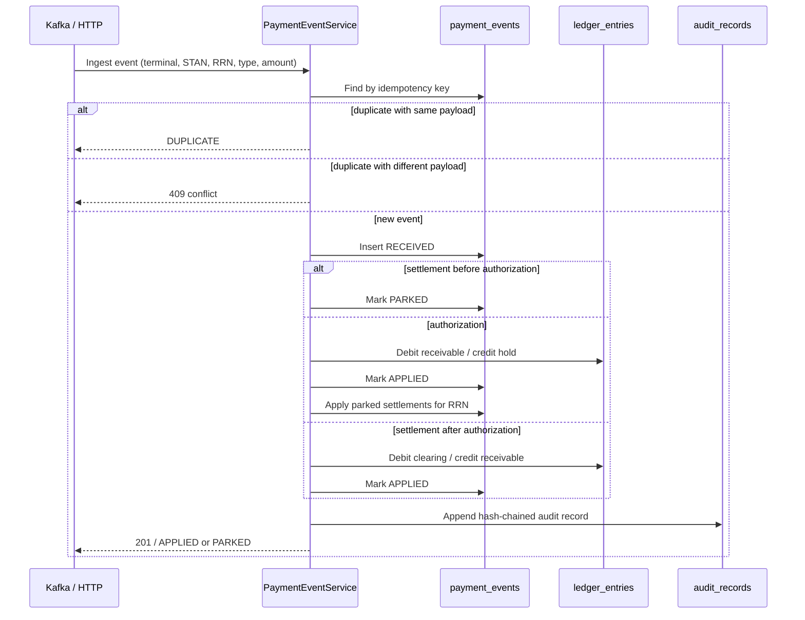
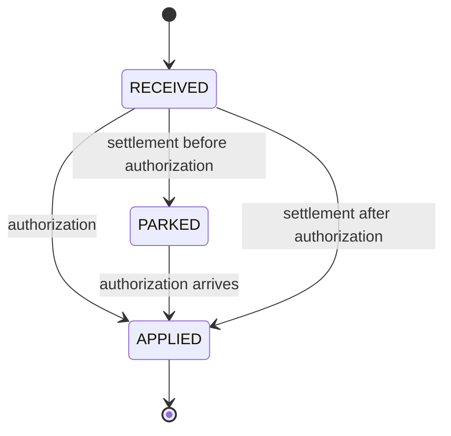

# Architecture

## Components

| Component | Responsibility |
| --- | --- |
| `PaymentEventController` | HTTP ingestion and RRN lookup |
| `KafkaPaymentEventConsumer` | Kafka ingestion using the same service path |
| `PaymentEventService` | Idempotency, parking, authorization matching, ledger postings |
| `ReconciliationService` | Classifies settlement rows and stores breaks |
| `AuditChainService` | SHA-256 hash-chained audit records |
| `DashboardService` | Aggregates event, ledger and reconciliation state |
| MySQL | Durable event, ledger, reconciliation and audit storage |
| Flyway | Versioned schema |
| Paymark-token UI | Operations snapshot and recent events |
| Terraform | SQS, DLQ, SNS and CloudWatch alarms |

## Ingestion path

## State machine

`REJECTED` is reserved for a future policy engine; the current service parks rather than rejects unknown ordering.

## Idempotency and ordering

- A natural key of `(terminal_id, stan, rrn, event_type)` prevents double-posting the same event type from the same terminal.
- `payload_hash` distinguishes a true replay from a conflicting payload.
- `sequence` and `event_time` provide a deterministic read order for the timeline.
- A settlement from another terminal (same RRN) is intentionally allowed; the reconciliation service treats it as a duplicate settlement rather than silently merging it.

## Ledger

Every event produces exactly two entries. The account pairs are:

- `AUTHORIZATION`: debit `MERCHANT_RECEIVABLE`, credit `AUTHORIZATION_HOLD`.
- `SETTLEMENT` / `CLEARING`: debit `SETTLEMENT_CLEARING`, credit `MERCHANT_RECEIVABLE`.
- `REVERSAL`: debit `AUTHORIZATION_HOLD`, credit `MERCHANT_RECEIVABLE`.
- `REFUND`: debit `MERCHANT_RECEIVABLE`, credit `SETTLEMENT_CLEARING`.

The dashboard exposes total debits, total credits and a balanced flag. The Java test suite asserts balance after an authorization + settlement pair.

## Reconciliation

For each settlement row, the service loads all events for the RRN and classifies:

| Condition | Break type |
| --- | --- |
| No applied authorization | `MISSING_AUTHORIZATION` |
| More than one applied settlement | `DUPLICATE_SETTLEMENT` |
| Authorization but no settlement | `DELAYED_SETTLEMENT` |
| Settlement amount differs | `AMOUNT_MISMATCH` |
| Amount and authorization match | `MATCHED` |

The independent Python CLI mirrors the same logic as a second control. In a real payments team, the Python control would run from a scheduled job against an extracted CSV while the Java service remains the operational path.

## Kafka

`KafkaPaymentEventConsumer` listens on `${app.kafka.topic:payment-events}` and delegates to `PaymentEventService`. It is disabled by default (`KAFKA_ENABLED=false`), so HTTP and tests do not require a broker. `docker-compose.yml` starts Redpanda when a full local stack is wanted.

## Data retention and audit

- `payment_events` is the operational timeline.
- `ledger_entries` is the financial record.
- `audit_records` is a hash-chained append-only-style log; the chain is verified by `AuditChainService.verifyChain()`.
- Reconciliation runs and breaks are retained for reporting.

Production should add retention policies, WORM storage for the audit head and a secrets manager rotation policy.

## Why this shape

The service is intentionally small enough to reason about during an incident:

- No external queue is required for the core path.
- Parking is a first-class state, not an exception.
- Reconciliation is a read model with explicit break types.
- The UI is a thin snapshot, not a source of truth.
