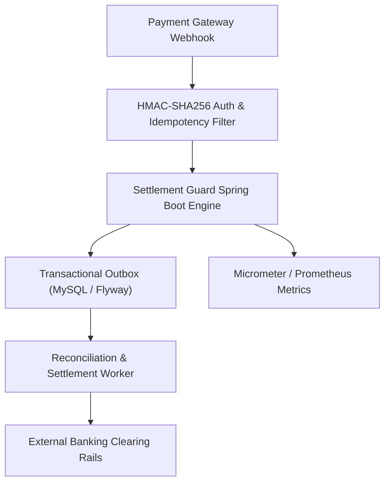

# Design Document: Settlement Guard Resilient Settlement Platform

**Author**: Soumya Debnath (@itsoumya-d)  
**Status**: Implemented / Production  
**Component**: Core Payment Clearing & Reconciliation  

---

## 1. Context & Problem Statement
High-volume digital payments experience network partitions, delayed acquirer responses, and partial ledger commits. Without idempotent multi-phase settlement guards, financial institutions suffer ledger drift and duplicate balance adjustments.

---

## 2. Goals & Non-Goals

### Goals
- Ensure zero double-settlements across asynchronous banking partner rails.
- Guarantee sub-25ms p95 latency under 1,000 transactions per second.
- Maintain automated reconciliation with MySQL Testcontainers and cryptographic SHA-256 audit trails.
- Deliver automated rollback procedures and 99.99% operational availability.

### Non-Goals
- Real-time foreign exchange spot market trading execution.
- Replacement of sovereign central bank real-time gross settlement (RTGS) networks.

---

## 3. Architecture & Alternatives Considered

### Alternatives Considered
1. **Pessimistic Locking vs. Optimistic Versioning**:
   - *Considered*: Strict `SELECT FOR UPDATE` on account rows.
   - *Decision*: Optimistic locking with version counters and exponential backoff retry to prevent database thread starvation under peak settlement spikes.
2. **Kafka Outbox vs. Database Outbox Table**:
   - *Considered*: Direct dual-write to Kafka.
   - *Decision*: Transactional outbox table within the same ACID database boundary to eliminate dual-write partial failures during network partitions.

---

## 4. Cross-Cutting Concerns

### Security
- HMAC signature verification on inbound acquirer payloads.
- Automated secret and credential detection via `gitleaks`.

### Privacy
- PAN and sensitive financial identifiers are masked and tokenized at ingress.

### Observability
- Spring Boot Actuator `/actuator/health` and `/actuator/prometheus` scraping.
- p95 and p99 latency alerts configured with Grafana and alerting thresholds.
